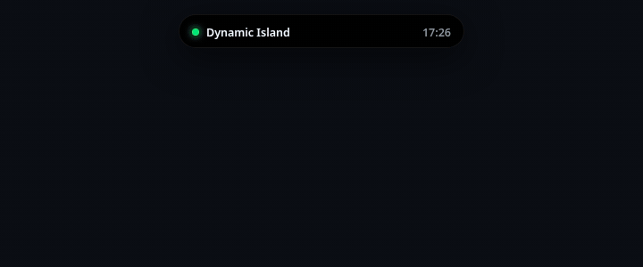

<p align="center">
  
</p>
<p align="center"><sub>6 s recording of the <a href="docs/index.html">interactive web demo</a> (a design preview, not a screen capture of the Windows app).</sub></p>

# Dynamic Island for Windows

[](LICENSE)

A small always-on-top pill for your Windows desktop that expands into music, weather, a Pomodoro timer, a calendar, battery status and your own widgets.

## Install

```bash
pipx install "dynamic-island-win[media] @ git+https://github.com/RanuK12/dynamic-island-win"
dynamic-island
```

That is the whole install. `pip install` works the same way. Drop `[media]` if you do not want the Windows now-playing support.

> Not published yet: the repository URL above is a placeholder, and there is no PyPI package or `.exe` download so far (both are on the [roadmap](#roadmap)).

Try it without touching your real data: `dynamic-island --demo` (fake track, sample alerts).

## Requirements

- Windows 10 or 11 for the full experience (see [Status](#status)). On Linux/macOS the window opens as a normal borderless window, which is handy for development.
- Python 3.10+ with Tk (the python.org installer includes it).
- Internet only for the weather widget (Open-Meteo, no account or API key).

## States

| State | What you see | Desktop app | [Web demo](docs/index.html) |
| --- | --- | :---: | :---: |
| Idle | Clock and date, small status dot | ✅ | ✅ |
| Timer | Pomodoro or countdown with ±1 min adjust, phase-end notifications | ✅ | ✅ |
| Music | Title, artist, play/pause/next/previous | ✅ (needs `[media]`) | ✅ |
| Weather | Current conditions and forecast for the city you set | ✅ | – |
| System | Battery, CPU, memory, low-battery notification | ✅ | – |
| Flight alert | Sample price-drop notification (off by default) | ✅ demo data only | ✅ |
| Call | Incoming / active call pill | – (not in the desktop app) | ✅ |

The web demo is a richer mock-up than the desktop app (for example it has a progress ring and progress bar that the desktop widgets do not draw yet). The "Call" and "Flight alert" states are shown to illustrate what the pill can do. In the desktop app the flight alert widget only emits **made-up sample alerts** (routes like `AAA → BBB`) and does not fetch fares; a real call integration does not exist yet.

## Configuration

Run `dynamic-island --init-config` to write a default `config.json` and `dynamic-island --print-config-path` to see where it lives (`%APPDATA%\DynamicIsland` on Windows). Set your city for the weather widget:

```json
{ "weather": { "city": "Lisbon", "units": "celsius" },
  "widgets": { "flight_alert": false } }
```

Nothing is sent anywhere except the weather request. There is no telemetry and no IP-based location lookup.

## Make your own widget

A widget is one Python file with a `register(registry)` function. See [docs/PLUGINS.md](docs/PLUGINS.md) and [`examples/hello_widget.py`](examples/hello_widget.py). Plugins run with your user's permissions, so only install code you trust.

## Status

Early (v0.1.0). Being upfront about what has and has not been verified:

- The timer, weather parsing, controller, config, plugin loading and the Tk window are covered by automated tests (see [CONTRIBUTING](CONTRIBUTING.md)), run on Linux under Xvfb with Python 3.10, 3.11 and 3.12. The centering test also runs with CustomTkinter's scaling forced to 150%.
- **Tried once on real Windows 11** (Python 3.12, 2560×1440 display at 150% scaling): the dependencies (including the `[media]` extra) install, 46 of the 47 tests then in the suite passed, and `dynamic-island --demo` opens without errors. That run found three problems at 150% scaling, fixed in the `fix/windows-dpi` branch: the pill was off-centre, the alert text was cut off at the right edge, and the one failing test compared a logical width with a scaled one.
- **Still not verified on real Windows:** the fixes above on a real 150% screen (only checked on Linux so far), other scales (100%, 200%, mixed-DPI multi-monitor), Windows 10, the now-playing integration (`winrt` installs, but playback was never exercised), window transparency at the corners, hiding from the taskbar, clicking and dragging, the expanded view, and the look with the Segoe UI font. Reports and screenshots are welcome.
- The web demo is a mock-up written in plain HTML/CSS/JS with sample data; it shares no code with the app.

## Contributing

Issues and pull requests are welcome. Start with [CONTRIBUTING.md](CONTRIBUTING.md).

## Roadmap

- [ ] Verify and polish on real Windows 10/11 (one 150% run so far), add real screenshots
- [ ] Windows `.exe` on the Releases page (PyInstaller)
- [ ] Publish to PyPI
- [ ] Autostart option
- [ ] More built-in widgets (quick notes, calendar events, clipboard history)
- [ ] Real notification sources (a real alert feed instead of demo data)

## Credits

The pill design is inspired by [RanuK12/Ranuk-Dynamic-Island](https://github.com/RanuK12/Ranuk-Dynamic-Island) (MIT). This project is an independent, generic rewrite and shares none of its personal configuration or integrations.

## License

[MIT](LICENSE)
